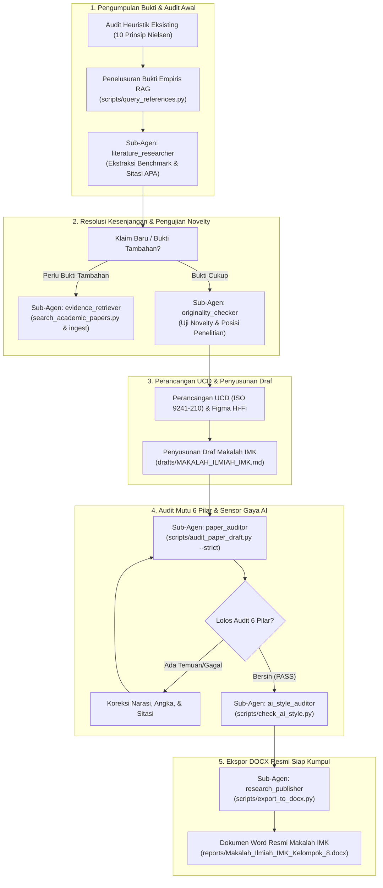

# ARCHITECTURE.md - Peta Arsitektur Sistem, Direktori Data, & Alur Orkestrasi Naskah IMK

Dokumen ini merupakan peta arsitektur teknis lengkap untuk repositori riset dan penyusunan naskah artikel ilmiah mata kuliah **Interaksi Manusia dan Komputer (IMK)** Politeknik Statistika STIS oleh **Kelompok 8** (Alif Zakiansyah As Syauqi, Andrian Fajar Fahmi, Valentina Lasma Situmorang) dengan topik:  
*"Redesain Website Dinas Pemadam Kebakaran Kota Bandar Lampung dengan Pendekatan User-Centered Design"* (damkar.bandarlampungkota.go.id).

Dokumen ini menyajikan topologi penyimpanan data, katalog perkakas CLI dan modul internal, serta alur koordinasi antar-sub-agen dalam menyusun naskah ilmiah bebas halusinasi.

---

## 🗺️ 1. Topologi Penyimpanan Data & Berkas Statis

Seluruh artefak riset disimpan dalam format teks terstruktur (Markdown, JSON, CSV, BibTeX, SQLite) dan dokumen resmi Word (.docx) agar transparan, terversikan di Git, dan mudah diaudit:

```text
IMK/
├── proposals/                 # Template resmi dan panduan naskah makalah IMK
│   ├── Template Makalah IMK.docx # Template makalah resmi IMK Politeknik Statistika STIS
│   └── README.md              # Panduan standar format penulisan makalah IMK
├── drafts/                    # Naskah artikel ilmiah terorkestrasi dan draf kerja
│   ├── MAKALAH_ILMIAH_IMK.md  # Naskah lengkap artikel ilmiah IMK (lolos audit 6 pilar)
│   ├── OUTLINE_PAPER_IMK.md   # Kerangka komprehensif naskah artikel ilmiah IMK
│   ├── laporan_proyek_imk/    # Draf kerja naskah komprehensif per bab/bagian laporan
│   │   ├── 01_pendahuluan.md
│   │   ├── 02_landasan_teori_hci.md
│   │   ├── 03_metodologi_evaluasi_dan_redesign.md
│   │   ├── 04_analisis_heuristik_website_eksisting.md
│   │   ├── 05_perancangan_ulang_ucd.md
│   │   ├── 06_evaluasi_webqual_dan_pembahasan.md
│   │   ├── 07_kesimpulan_dan_saran.md
│   │   └── laporan_lengkap_imk.md
│   └── published/             # Berkas kompilasi dan ekspor terbitan
├── reports/                   # Dokumen Word (.docx) resmi hasil publikasi
│   └── Makalah_Ilmiah_IMK_Kelompok_8.docx # Berkas naskah Word final siap kumpul
├── references/                # Koleksi referensi paper ilmiah peer-reviewed & template jurnal
│   ├── verified_papers.json   # Pangkalan data metadata 28+ paper peer-reviewed terverifikasi
│   ├── references_zotero_import.bib # Ekspor BibTeX terstandarisasi untuk Zotero Desktop
│   ├── references_zotero_import.ris # Ekspor RIS untuk Zotero Desktop
│   ├── template/              # Direktori template tambahan (referensi umum jurnal ilmiah)
│   ├── markdown/              # Teks utuh Markdown 28 paper untuk RAG penelusuran bukti empiris
│   └── papers/                # Koleksi berkas PDF referensi ilmiah terverifikasi
├── results/                   # Artefak hasil evaluasi usabilitas, kuesioner WebQual 4.0, & komparasi before-after
├── literature/                # Basis data empiris literatur ilmiah & indeks pencarian
│   ├── references.bib         # Berkas sitasi master standar BibTeX terpadu (peer-reviewed papers)
│   ├── theses_data.json       # Database skripsi alumni STIS (khusus analisis gap internal)
│   ├── theses_archive.bib     # Arsip sitasi skripsi alumni STIS (dilarang disitir dalam naskah)
│   └── search_index/          # Indeks hybrid retrieval lokal (SQLite, embeddings, BM25)
├── scratchpad/                # Jurnal kerja harian dan rekaman keputusan tim riset
│   └── daily_notes.md         # Catatan log harian, profil proyek, dan status milestone
├── docs/                      # Dokumentasi teknis terperinci per modul
├── scripts/                   # Perkakas baris perintah (executable CLI scripts)
├── src/calm_carson/           # Paket Python internal modular (metadata, search, verify, publisher, drafting)
└── tests/                     # Suite pengujian otomatis (68 unit tests passing)
```

---

## 🛠️ 2. Katalog Perkakas CLI & Modul Internal Python

Workspace ini dilengkapi dengan modul riset & publikasi ilmiah yang dapat dieksekusi melalui `uv run python scripts/<script_name>.py`:

| # | Skrip & Modul Python | Fungsi Utama | Parameter Kunci | Berkas Dokumentasi |
|---|---|---|---|---|
| **1** | `scripts/audit_paper_draft.py`<br>`src/calm_carson.verify` | Audit 6 pilar artikel ilmiah (grounding klaim empiris, pencegahan skripsi SIMPUS, audit bibtex APA, rekonsiliasi angka evaluasi WebQual, kepatuhan template IMK, sensor gaya AI). | `--file <DRAFT_MD>`<br>`--strict`<br>`--json` | [`.agents/skills/paper-auditor/`](file:///home/alfzki/Documents/IMK/.agents/skills/paper-auditor/SKILL.md) |
| **2** | `scripts/query_references.py`<br>`src/calm_carson.search` | Temu-balik kutipan bukti empiris dan benchmark dari koleksi paper peer-reviewed terverifikasi lokal. | `--query "<KUERI>"`<br>`--limit 3`<br>`--citekey <KEY>` | [`.agents/skills/paper-reference-rag/`](file:///home/alfzki/Documents/IMK/.agents/skills/paper-reference-rag/SKILL.md) |
| **3** | `scripts/search_academic_papers.py`<br>`src/calm_carson.archives` | Penelusuran publikasi ilmiah global multi-platform (OpenAlex, Crossref, arXiv, Semantic Scholar) dengan auto-ingestion ke RAG. | `--query "<KUERI>"`<br>`--platform all`<br>`--auto-ingest 1` | [`.agents/skills/claim-reference-finder/`](file:///home/alfzki/Documents/IMK/.agents/skills/claim-reference-finder/SKILL.md) |
| **4** | `scripts/ingest_new_reference.py`<br>`src/calm_carson.metadata` | Ingesti referensi baru ke `references/` & Zotero dengan penolakan ketat skripsi SIMPUS STIS. | `--pdf <FILE_PDF>`<br>`--doi <DOI>`<br>`--citekey <KEY>` | [`.agents/skills/claim-reference-finder/`](file:///home/alfzki/Documents/IMK/.agents/skills/claim-reference-finder/SKILL.md) |
| **5** | `scripts/prepare_zotero_import.py`<br>`src/calm_carson.metadata` | Generasi berkas import pustaka Zotero Desktop (`references_zotero_import.bib` dan `.ris`). | None | [`references/`](file:///home/alfzki/Documents/IMK/references/) |
| **6** | `scripts/export_to_docx.py`<br>`src/calm_carson.publisher` | Konversi draf Markdown ke DOCX ilmiah dengan persamaan matematika OMML native & APA hanging indent. | `--input <MD>`<br>`--output <DOCX>` | [`proposals/`](file:///home/alfzki/Documents/IMK/proposals/) |
| **7** | `scripts/check_ai_style.py`<br>`src/calm_carson.style` | Auditor gaya penulisan AI (Signs of AI Writing), em dash PUEBI, klise dwibahasa, & kebocoran LLM. | `--file <PATH_MD>`<br>`--text "<PARAGRAF>"`<br>`--suggest-fixes` | [`docs/ai_style_checker.md`](file:///home/alfzki/Documents/IMK/docs/ai_style_checker.md) |
| **8** | `scripts/verify_claims.py`<br>`src/calm_carson.verify` | Auditor keabsahan klaim faktual, deteksi kontradiksi angka empiris, dan audit sitasi. | `--file <PATH_MD>`<br>`--text "<PARAGRAF>"`<br>`--strict` | [`docs/fact_verification.md`](file:///home/alfzki/Documents/IMK/docs/fact_verification.md) |
| **9** | `scripts/hybrid_search.py`<br>`src/calm_carson.search` | Temu-balik hybrid dokumen Markdown (Hierarchical Chunker, BM25Okapi, Dense CUDA, RRF). | `--query "<KUERI>"`<br>`--top-k 5` | [`docs/hybrid_retrieval.md`](file:///home/alfzki/Documents/IMK/docs/hybrid_retrieval.md) |
| **10** | `scripts/publish_document.py`<br>`src/calm_carson.publisher` | Validasi kepatuhan template makalah IMK, renumbering sitasi, dan kompilasi .docx & .pdf. | `--input <PATH_MD>`<br>`--template <DOCX>`<br>`--format all` | [`docs/publishing_pipeline.md`](file:///home/alfzki/Documents/IMK/docs/publishing_pipeline.md) |

---

## 🤖 3. Alur Koordinasi Antar-Sub-Agen & Siklus End-to-End Naskah IMK

Penyusunan dan audit naskah artikel ilmiah IMK dilakukan melalui siklus terpadu 5 tahapan:



### Rincian Peran Sub-Agen:

1. **`paper_auditor`**:
   - Berperan sebagai *Paper Gatekeeper & Strict Fact-Checker*.
   - Menguji naskah secara komprehensif via `audit_paper_draft.py`: memastikan bebas klaim tanpa bukti (`[KLAIM_BELUM_TERVERIFIKASI]`), memblokir keras penggunaan skripsi SIMPUS (`[SIMPUS_THESIS_DISALLOWED]`), memverifikasi keselarasan 100% antara angka narasi dan tabel evaluasi WebQual 4.0 / Heuristik, serta membersihkan klise AI.
2. **`literature_researcher`**:
   - Berperan sebagai *Literature & Empirical Benchmark Specialist*.
   - Menggali sitasi terverifikasi, kutipan bukti empiris, dan perbandingan performa dari paper katalog open access peer-reviewed lokal (`references/markdown/`).
3. **`evidence_retriever`**:
   - Berperan sebagai *Missing Evidence & External Literature Retriever*.
   - Mencari paper baru via arXiv, Crossref, OpenAlex, Semantic Scholar saat ada klaim yang belum terbukti, mengunduh PDF, dan memasukkannya ke RAG & Zotero.
4. **`ai_style_auditor`**:
   - Berperan sebagai *Academic Style & AI Tell Auditor*.
   - Mengaudit draf dari tanda-tanda penulisan AI (Wikipedia:Signs_of_AI_writing), mendeteksi klise kosakata dwibahasa, menganalisis ketepatan tanda pisah (em dash PUEBI), menyaring anak kalimat partisipel pemanis, dan mengevaluasi burstiness.
5. **`claim_verifier`**:
   - Berperan sebagai *Factual Integrity & Citation Verifier*.
   - Membedah teks menjadi klaim atomik, mencocokkan angka kuantitatif terhadap korpus lokal via hybrid search, menandai kontradiksi, dan memastikan seluruh klaim terlindungi sitasi APA/IEEE valid.
6. **`originality_checker`**:
   - Berperan sebagai *Critical Reviewer & Novelty Evaluator*.
   - Memindai literatur global untuk menguji posisi kebaruan penelitian redesain portal darurat kebencanaan berbasis UCD dan WebQual 4.0.
7. **`research_publisher`**:
   - Berperan sebagai *Scientific Document Formatter & Exporter*.
   - Memvalidasi struktur template makalah IMK dan mengompilasi naskah Markdown ke dokumen DOCX berstandar resmi via `scripts/export_to_docx.py`.

---

## 🔒 4. Jaminan Integritas & Kepatuhan Antigravity

- **Zero Host Mutation**: Seluruh eksekusi berjalan di dalam lingkungan terisolasi virtualenv `.venv` (`uv run`).
- **Disk-First State**: Progres tidak bergantung pada riwayat percakapan yang fana. Setiap status terekam di `drafts/MAKALAH_ILMIAH_IMK.md`, `reports/Makalah_Ilmiah_IMK_Kelompok_8.docx`, dan `scratchpad/daily_notes.md`.
- **Reproducible Pipeline**: Setiap artefak didukung oleh unit test suite (68 unit tests) yang dapat diverifikasi kapan saja via `uv run python -m unittest discover tests`.
- **Strict SIMPUS Isolation**: Skripsi alumni STIS dari SIMPUS diisolasi khusus untuk analisis kesenjangan historis internal (`theses_archive.bib`), dan dicegah secara mutlak dari bibliografi atau sitasi naskah artikel ilmiah. Seluruh referensi paper wajib berasal dari publikasi peer-reviewed terverifikasi.
