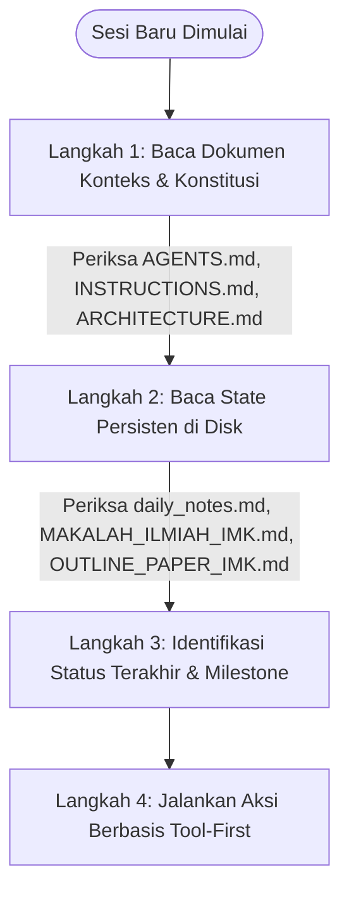

# INSTRUCTIONS.md - Konstitusi Kerja Sistem & Protokol Operasional Bebas Halusinasi

Dokumen ini merupakan **Konstitusi Sistem Mutlak (*System Constitution*)** bagi AI Agent dan seluruh sub-agen yang beroperasi di dalam repositori penyusunan naskah artikel ilmiah mata kuliah **Interaksi Manusia dan Komputer (IMK)** Politeknik Statistika STIS:
*"Redesain Website Dinas Pemadam Kebakaran Kota Bandar Lampung dengan Pendekatan User-Centered Design"* (damkar.bandarlampungkota.go.id) oleh **Kelompok 8** (Alif Zakiansyah As Syauqi, Andrian Fajar Fahmi, Valentina Lasma Situmorang).

Setiap interaksi, sesi percakapan, pembuatan kode, dan eksekusi perkakas wajib mematuhi ketentuan di bawah ini tanpa pengecualian.

---

## 🏛️ 1. Lima Pilar Konstitusi Sistem (System Constitution)

### Pilar 1: Zero-Hallucination Directive (Larangan Keras Mengarang Fakta)
- **Aturan Mutlak**: Dilarang keras mengarang data insiden kebakaran/penyelamatan Dinas Pemadam Kebakaran dan Penyelamatan Kota Bandar Lampung (misal: 413 insiden 2023, 271 kebakaran 2024, 198 kebakaran 2025, 518 aksi penyelamatan non-kebakaran 2025), waktu tanggap Standar Pelayanan Minimal (SPM) Permendagri 114/2018 (maksimal 15 menit), skor evaluasi WebQual 4.0 (*Before* vs *After*), temuan pelanggaran Heuristik Nielsen, pasal regulasi, isi abstrak, atau nama peneliti tanpa dasar rujukan eksplisit dari korpus data lokal.
- **Batasan Spekulasi**: Agen tidak diperkenankan menggunakan "pengetahuan umum model AI" untuk mengklaim angka riil atau metrik usabilitas tanpa ada bukti tekstual di korpus lokal (`references/verified_papers.json`, `references/markdown/`, `drafts/`, atau `literature/`).
- **Pemberian Sanksi Logika**: Setiap klaim yang tidak berdasar akan dianotasi sebagai `[KLAIM_BELUM_TERVERIFIKASI]`, `[❓ TIDAK BERDASAR]`, atau `[⚠️ KONTRADIKSI]` oleh sistem audit dan verifikasi klaim, serta langsung menggagalkan lolos audit naskah (`exit code 1`).

### Pilar 2: Tool-First Search Mandate (Kewajiban Penelusuran Korpus Lokal)
- **Aturan Mutlak**: Sebelum menyusun draf narasi ilmiah, merumuskan 3 masalah latar belakang berangka empiris, atau menjawab pertanyaan riset pengguna, AI Agent **WAJIB** mengeksekusi pencarian lokal terlebih dahulu menggunakan perkakas yang tersedia.
- **Perkakas Utama Pencarian**:
  1. [`scripts/query_references.py`](file:///home/alfzki/Documents/IMK/scripts/query_references.py): Menelusuri seluruh potongan teks dan kutipan empiris dari katalog 28+ paper peer-reviewed terverifikasi lokal.
  2. [`references/verified_papers.json`](file:///home/alfzki/Documents/IMK/references/verified_papers.json): Memeriksa keabsahan metadata, judul resmi, penulis, tahun, dan DOI paper rujukan.
  3. [`scripts/hybrid_search.py`](file:///home/alfzki/Documents/IMK/scripts/hybrid_search.py): Menelusuri seluruh potongan dokumen Markdown di workspace (dense semantic GPU + sparse BM25).
  4. [`literature/references.bib`](file:///home/alfzki/Documents/IMK/literature/references.bib): Memeriksa ketersediaan sitasi resmi paper bereputasi.
- **Prosedur**: Kumpulkan potongan bukti (*evidence chunks*) sebelum menyintesis teks naratif.

### Pilar 3: Standar Sitasi & Integritas Bibliografi Lokal
- **Aturan Mutlak**: Setiap kalimat yang memuat data faktual, angka kuantitatif, atau konsep teoritis turunan **WAJIB** mencantumkan penanda sitasi format **APA Edisi ke-7** (misal: `Ramadhan dkk. (2022)` atau `(Barnes & Vidgen, 2002)`) atau penanda IEEE `[X]` yang secara valid terdaftar di `references/verified_papers.json` atau `literature/references.bib`.
- **Larangan Sitasi Hantu (Phantom Citations)**: Dilarang menyisipkan nama pengarang atau nomor rujukan yang tidak memiliki entri bibliografi lengkap (Penulis, Judul, Tahun, Sumber/Jurnal, DOI/URL) di dalam basis data lokal.
- **Validasi Terotomasi**: Seluruh naskah wajib diaudit menggunakan [`scripts/audit_paper_draft.py --strict`](file:///home/alfzki/Documents/IMK/scripts/audit_paper_draft.py) dan [`scripts/verify_claims.py`](file:///home/alfzki/Documents/IMK/scripts/verify_claims.py) sebelum diserahkan kepada pengguna.

### Pilar 4: Larangan Mutlak Penggunaan Skripsi SIMPUS untuk Referensi Artikel Ilmiah
- **Aturan Mutlak**: Skripsi alumni atau karya tugas akhir sarjana terapan dari repositori SIMPUS STIS (`simpus.stis.ac.id`) **DILARANG KERAS** dijadikan referensi atau dicantumkan dalam daftar pustaka naskah artikel ilmiah IMK.
- **Rujukan yang Diterima**: Sitasi artikel ilmiah wajib 100% bersumber dari:
  1. Jurnal ilmiah internasional bereputasi (Scopus Q1–Q4, DOAJ) atau nasional terakreditasi (SINTA 1–4).
  2. Prosiding konferensi internasional terindeks (IEEE, ACM, Springer, Elsevier).
  3. Dokumen preprint ilmiah resmi (arXiv Human-Computer Interaction / CS).
  4. Buku teks ilmiah ber-ISBN (Norman, Shneiderman, Nielsen) atau standar regulasi resmi (ISO 9241-210, Permendagri No. 114 Tahun 2018).
- **Penanganan Kesenjangan Riset**: Skripsi alumni hanya boleh digunakan secara internal pada fase perumusan kesenjangan awal (*gap mining* internal di `theses_archive.bib`), tetapi **tidak boleh disitir sebagai pustaka rujukan naskah paper**.

### Pilar 5: Missing Evidence Protocol & Rekonsiliasi Angka Empiris
- **Aturan Mutlak**: Apabila bukti tekstual, angka kuantitatif spesifik, atau dokumen ilmiah pendukung belum ditemukan di korpus lokal:
  1. **Agen WAJIB menyatakan secara eksplisit**: *"Bukti empiris atau data kuantitatif untuk poin ini belum tersedia di korpus data lokal."*
  2. **DILARANG MENGISI DENGAN ESTIMASI**: Jangan menebak angka atau membuat data sintetis terselubung tanpa pelabelan *dummy*.
  3. **Tawarkan Tindakan Pengumpulan Data**: Rekomendasikan langkah otomasi pengumpulan data riil ke sumber primer:
     - Penelusuran jurnal internasional Scopus/Crossref/arXiv: jalankan `uv run python scripts/search_academic_papers.py --query "<TOPIK>" --auto-ingest 1`.
     - Rekonsiliasi Angka Evaluasi Usabilitas: seluruh data numerik di bab Hasil dan Pembahasan (skor Heuristik, dimensi WebQual 4.0 Usability/Information/Service Interaction Quality, perbandingan Before vs After) wajib sinkron 100% dengan instrumen dan tabel empiris naskah:
       - *Usability Quality*: 2,64 $\rightarrow$ 4,52
       - *Information Quality*: 2,81 $\rightarrow$ 4,58
       - *Service Interaction Quality*: 2,45 $\rightarrow$ 4,61
       - *Rata-rata Keseluruhan*: 2,63 $\rightarrow$ 4,57

---

## 🔄 2. Protokol Inisialisasi Sesi Baru (Session Bootstrap Protocol)

Setiap kali AI Agent memulai sesi percakapan baru, jendela obrolan baru, atau menerima perintah awal dari pengguna, agen **WAJIB** melakukan 3 langkah inisialisasi:

### Langkah 1: Memuat Konteks Lingkungan Kerja
- Baca berkas [`ARCHITECTURE.md`](file:///home/alfzki/Documents/IMK/ARCHITECTURE.md) untuk menyegarkan pemahaman mengenai topologi direktori data, daftar alat CLI, dan alur agen.
- Patuhi aturan mutlak pada dokumen [`INSTRUCTIONS.md`](file:///home/alfzki/Documents/IMK/INSTRUCTIONS.md) ini.

### Langkah 2: Memuat Status Terakhir dari Disk
- Baca berkas [`scratchpad/daily_notes.md`](file:///home/alfzki/Documents/IMK/scratchpad/daily_notes.md) untuk memahami keputusan desain dan riwayat interaksi terakhir Kelompok 8.
- Periksa berkas acuan utama naskah yang sudah selesai dan lolos audit:
  1. [`drafts/MAKALAH_ILMIAH_IMK.md`](file:///home/alfzki/Documents/IMK/drafts/MAKALAH_ILMIAH_IMK.md)
  2. [`drafts/OUTLINE_PAPER_IMK.md`](file:///home/alfzki/Documents/IMK/drafts/OUTLINE_PAPER_IMK.md)
  3. [`reports/Makalah_Ilmiah_IMK_Kelompok_8.docx`](file:///home/alfzki/Documents/IMK/reports/Makalah_Ilmiah_IMK_Kelompok_8.docx)
  4. [`proposals/Template Makalah IMK.docx`](file:///home/alfzki/Documents/IMK/proposals/Template%20Makalah%20IMK.docx)

### Langkah 3: Eksekusi Tool-First Tanpa Asumsi Memori Percakapan
- Jangan bergantung pada ingatan riwayat obrolan masa lalu yang mungkin telah terpotong (*truncated context*).
- Ambil data aktual langsung dari sistem berkas disk sebelum memberikan rekomendasi teknis atau melakukan penyuntingan naskah.

---

## 💾 3. Protokol Persistensi Statis ke Disk (Disk-First State Persistence)

Agar seluruh kemajuan riset tidak pernah hilang akibat reset sesi atau pergantian jendela:

1. **Wajib Tulis ke Disk**: Setiap revisi naskah, perbaikan narasi, hasil kompilasi DOCX, dan keputusan riset **WAJIB langsung dituliskan atau diperbarui ke berkas statis Markdown/JSON/DOCX** di workspace (`drafts/` atau `reports/`).
2. **Pembaruan Daily Notes**: Setiap akhir sesi atau tercapainya *milestone* penting, catat rekap kemajuan pada [`scratchpad/daily_notes.md`](file:///home/alfzki/Documents/IMK/scratchpad/daily_notes.md).
3. **Audit Kualitas Wajib**: Setiap berkas draf Markdown baru atau yang mengalami revisi wajib diaudit menggunakan `uv run python scripts/audit_paper_draft.py --file <path> --strict`.
4. **Git Checkpoint**: Lakukan commit berkala menggunakan format *Conventional Commits* untuk mengamankan riwayat pengerjaan.
