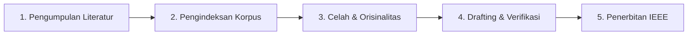

# Panduan Praktis: Universal Agentic Research Workflow
## Toolkit Otomasi Penyusunan Makalah Penelitian Ilmiah Bebas Halusinasi

Toolkit ini adalah kerangka kerja (*framework*) riset terpadu berbasis AI Agent dan perkakas CLI modern untuk menyusun **makalah penelitian ilmiah, artikel jurnal (Scopus/SINTA), prosiding konferensi internasional (IEEE/ACM), tesis/disertasi, serta proposal penelitian** secara sistematis, berbasis bukti (*evidence-grounded*), dan bebas dari halusinasi model AI.

---

## 🌟 Fitur Utama Toolkit

1. **Multi-Tier Public Archive Scraper**:
   - Menelusuri jutaan publikasi global via OpenAlex API & arXiv.
   - Mengintegrasikan 9 arsip ilmiah publik terbuka (Semantic Scholar, CORE, Internet Archive, Project Gutenberg, SciHub, LibGen, Anna's Archive, IPFS, dan Z-Library) dengan mekanisme unduh multi-tier otomatis.
2. **GPU-Accelerated PDF-to-Markdown (Marker CUDA)**:
   - Mengonversi berkas PDF artikel ilmiah menjadi teks Markdown bersih dengan pengekstrakan rumus LaTeX dan tabel berformat Markdown.
3. **Pengekstrakan Metadata & Generator BibTeX Terpadu**:
   - Mengekstrak DOI, arXiv ID, judul, penulis, tahun, dan abstrak otomatis dari PDF atau pengenal DOI.
   - Menghasilkan berkas `references.bib` standar BibTeX terintegrasi.
4. **Mesin Temu-Balik Dokumen Hibrida (Hybrid Search Engine)**:
   - Memadukan pemeringkatan leksikal *BM25Okapi* dan pemeringkatan semantik dense (*SentenceTransformers* berakselerasi GPU NVIDIA CUDA FP16).
   - Penggabungan skor berbasis *Reciprocal Rank Fusion (RRF)* untuk temu-balik bukti ilmiah yang sangat presisi.
5. **Evaluasi Kebaruan & Orisinalitas Ide (Novelty Checker)**:
   - Membandingkan kueri ide riset terhadap publikasi global secara *real-time*.
   - Memberikan skor irisan (*overlap score*) dan merumuskan matriks diferensiasi (*differentiation strategy*).
6. **Auditor Keabsahan Faktual & Integritas Sitasi (Claim Verifier)**:
   - Membedah narasi menjadi klaim atomik.
   - Mencocokkan angka kuantitatif terhadap korpus lokal via *number-boosted retrieval*.
   - Mendeteksi kontradiksi (*CONTRADICTED*) dan memastikan seluruh klaim terlindungi sitasi IEEE valid.
7. **Auditor Gaya Penulisan AI (Signs of AI Writing)**:
   - Berdasarkan taksonomi formal *Wikipedia:Signs_of_AI_writing*.
   - Mendeteksi klise kosakata dwibahasa (*delve, intricate tapestry, memainkan peran penting, lanskap yang dinamis*).
   - Menertibkan tanda pisah (*em dash*) sesuai PUEBI (tanpa spasi), menyaring gerund pemanis (*superficial analysis*), dan mengukur variansi ritme kalimat (*burstiness*).
8. **Penyusunan Naskah Terorkestrasi (Evidence-Grounded Drafter)**:
   - Alur kerja semi-otomatis penyusunan bab demi bab.
   - Sintesis narasi berbasis bukti korpus lokal.
   - Titik kendali pengguna (*human-in-the-loop checkpoint*) untuk menyetujui, mengedit, atau menulis ulang draf.
9. **Penerbit Dokumen Ilmiah Resmi (Scientific Document Publisher)**:
   - Validasi kepatuhan format IEEE dua kolom.
   - *Auto-renumbering* nomor sitasi [1], [2], dst. berurutan sesuai kemunculan pertama di narasi.
   - Kompilasi otomatis ke format Word (.docx) dan PDF siap submit (*headless* LibreOffice).
10. **5 Keahlian Sub-Agen Antigravity Terintegrasi**:
    - Dilengkapi folder `.agents/skills/` siap pakai untuk `topic-brainstormer`, `originality-checker`, `claim-verifier`, `ai-style-auditor`, dan `research-publisher`.

---

## 🚀 Alur Kerja 5 Tahap: Dari Ide Menjadi Makalah Siap Terbit



---

### Tahap 1: Pengumpulan Paper & Literatur Global

Gunakan perkakas pencarian internasional untuk mengunduh literatur ilmiah yang relevan dengan topik riset Anda:

```bash
# Mencari dan mengunduh publikasi ilmiah terkini (OpenAlex & arXiv):
uv run python scripts/scrape_international.py \
  --query "privacy-preserving machine learning differential privacy" \
  --sources academic,books \
  --download-pdf \
  --limit 10

# Mengekstrak metadata resmi dan membangun berkas references.bib:
uv run python scripts/extract_metadata.py \
  --input literature/pdfs/ \
  --output-bib literature/references.bib
```

Jika Anda memiliki berkas PDF mentah, konversikan ke Markdown berformat rumus LaTeX:
```bash
uv run python scripts/convert_pdf_to_md.py --batch-dir literature/pdfs/ --workers 2
```

---

### Tahap 2: Pembangunan Indeks Temu-Balik Hibrida

Bangun indeks leksikal BM25 dan vektor semantik CUDA dari korpus literatur yang telah dikonversi ke Markdown:

```bash
# Membangun indeks dari seluruh korpus dokumen:
uv run python scripts/hybrid_search.py --reindex

# Menguji pencarian bukti ilmiah spesifik:
uv run python scripts/hybrid_search.py \
  --query "Laplace mechanism privacy budget epsilon composition" \
  --top-k 3
```

---

### Tahap 3: Eksplorasi Celah Riset & Uji Orisinalitas (Novelty Check)

Isi profil penelitian Anda di `brainstorming/01_research_profile.md`, lalu uji ide penelitian terhadap literatur global:

```bash
# Menguji kebaruan ide riset terhadap publikasi Scopus & arXiv:
uv run python scripts/check_originality.py \
  --idea "Design and Implementation of Low-Latency Differential Privacy Middleware for Stream Analytics" \
  --export
```

Periksa laporan di berkas JSON dan Markdown yang dihasilkan. Pastikan ide berada pada zona *Low Overlap* atau memiliki strategi pembeda yang tajam.

---

### Tahap 4: Penyusunan Naskah, Verifikasi Faktual, & Audit Gaya Bahasa AI

Jalankan orkestrasi penyusunan naskah bab demi bab berbasis bukti:

```bash
# Menjalankan orkestrasi draf secara interaktif:
uv run python scripts/orchestrate_drafting.py \
  --topic "Low-Latency Differential Privacy Middleware" \
  --scope proposal \
  --output-dir drafts/my_paper

# Memverifikasi keabsahan faktual dan angka kuantitatif pada draf:
uv run python scripts/verify_claims.py \
  --file drafts/my_paper/bab_1_pendahuluan.md \
  --strict \
  --export

# Mengaudit draf dari tanda-tanda penulisan AI (klise, em dash, burstiness):
uv run python scripts/check_ai_style.py \
  --file drafts/my_paper/bab_1_pendahuluan.md \
  --suggest-fixes \
  --export
```

---

### Tahap 5: Format Standar IEEE & Penerbitan (.docx & .pdf)

Setelah seluruh bagian naskah selesai disusun dan dirakit:

```bash
# Validasi kepatuhan struktur, rapikan nomor sitasi, dan kompilasi naskah:
uv run python scripts/publish_document.py \
  --input drafts/my_paper/naskah_lengkap.md \
  --template "proposals/Template Proposal Penelitian.docx" \
  --auto-renumber \
  --format all
```

Hasil terbitan berkas Word (.docx) dua kolom berformat resmi dan PDF siap kirim akan tersimpan di direktori `drafts/published/`.

---

## 🤖 Integrasi dengan Antigravity AI Agent & Skills

Jika Anda menjalankan workspace ini di dalam **Google Antigravity IDE**:

1. **Skills Otomatis Terdaftar**:
   - Seluruh skill di dalam `.agents/skills/` langsung dikenali oleh sistem Antigravity:
     - `ai-style-auditor`: Mengaudit draf dari klise LLM dan cacat tipografi.
     - `topic-brainstormer`: Memandu penemuan gap riset dan rumusan masalah.
     - `originality-checker`: Mengevaluasi kebaruan ide terhadap dunia ilmiah global.
     - `claim-verifier`: Menjaga naskah bebas halusinasi dengan mencocokkan angka empiris.
     - `research-publisher`: Mengompilasi naskah ke template resmi IEEE.
2. **Sub-Agen Kolaboratif**:
   - Agen utama dapat mendelegasikan tugas khusus ke sub-agen spesialis menggunakan alat `invoke_subagent` (misal: memanggil `claim_verifier` saat audit naskah).
3. **Prinsip Zero-Hallucination**:
   - AI Agent selalu tunduk pada aturan di `INSTRUCTIONS.md`: dilarang berspekulasi atau mengarang data tanpa dasar bukti rujukan di korpus lokal.

---

## 📋 Struktur Direktori Proyek Baru

```text
my-research-project/
├── .agents/skills/            # 5 keahlian agen AI riset ilmiah
├── brainstorming/             # Profil riset, pemetaan ide, & laporan novelty
├── docs/                      # Dokumentasi teknis lengkap tiap perkakas (11 panduan)
├── drafts/                    # Naskah per bab dan berkas terbitan akhir
├── literature/                # Koleksi PDF, Markdown hasil konversi, references.bib, & indeks hybrid
├── proposals/                 # Template resmi IEEE dua kolom (.docx)
├── scripts/                   # 10 executable script baris perintah
├── src/calm_carson/           # Engine Python modular
├── tests/                     # Suite pengujian otomatis (60 unit tests)
├── pyproject.toml             # Konfigurasi dependensi uv
├── QUICKSTART_UNIVERSAL.md    # Panduan alur riset universal (berkas ini)
├── INSTRUCTIONS.md            # Konstitusi kerja bebas halusinasi
└── ARCHITECTURE.md            # Diagram arsitektur dan katalog modul
```

---

## 🧪 Menjalankan Pengujian Otomatis

Untuk memastikan seluruh lingkungan komputasi dan dependensi berjalan prima:
```bash
uv run python -m unittest discover tests
```
Semua 60 unit tests wajib menghasilkan status `OK`.
