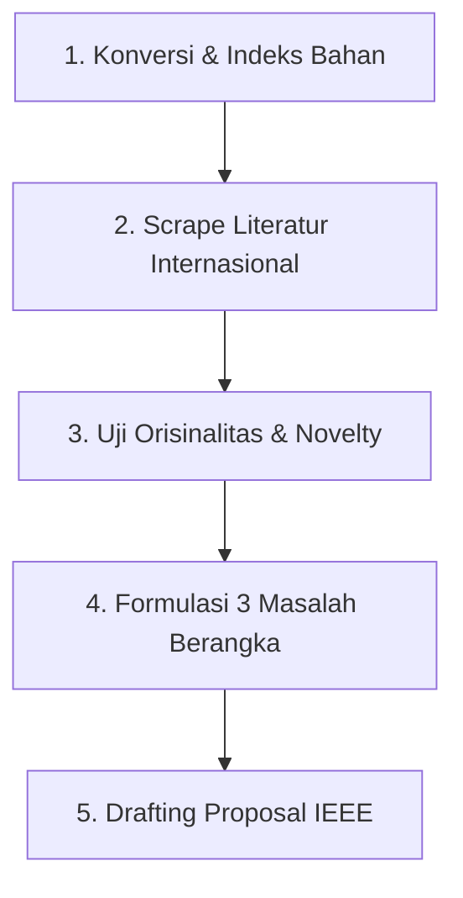

# Pemetaan Topik Penelitian & Analisis Berkas Direktori External Source

Dokumen ini menyajikan dekomposisi komprehensif terhadap seluruh artefak penelitian yang terdapat pada direktori `External source/`, sintesis peluang topik skripsi peminatan **Sistem Informasi Statistik (SIS)**, serta rekomendasi langkah teknis dalam alur kerja agentic research framework.

---

## 1. Dekomposisi Berkas Sumber Eksternal (External Source)

Direktori `External source/` memuat 6 dokumen ilmiah dan laporan proyek mata kuliah **Interaksi Manusia dan Komputer (IMK)** yang disusun oleh **Alif Zakiansyah As Syauqi (NIM: 222312958)** bersama tim (Andrian Fajar Fahmi dan Valentina Lasma Situmorang) pada program studi D-IV Komputasi Statistik Polstat STIS:

```
External source/
├── 222312958_Alif Zakiansyah As Syauqi_Tugas Pertemuan 4.pdf  (UCD Framework)
├── 22212958_Alif Zakiansyah As Syauqi_Tugas Pertemuan 5.pdf  (WebQual 4.0 Methodology)
├── 222312958_Alif Zakiansyah As Syauqi_Tugas Pertemuan 6.pdf  (Direct Manipulation)
├── 222312958_Alif Zakiansyah As Syauqi_IMK 7.pdf              (Fluid Navigation)
├── 222312958_Alif Zakiansyah As Syauqi_Tugas Pertemuan 8.pdf  (Emotional Design)
└── Kelompok 8_Evaluasi Website Bandar Lampung.pdf             (Comprehensive Redesign Project)
```

### Rincian Konten Tiap Dokumen:

| No | Berkas | Landasan Teori Utama | Kasus / Objek Studi | Kontribusi & Temuan Utama |
|:---:|:---|:---|:---|:---|
| 1 | **Tugas Pertemuan 4** | *User-Centered Design* (ISO 9241-210) & Ben Shneiderman | Layanan Darurat Kebencanaan (Damkar Serang) | Merumuskan 4 fase siklus UCD: *Understand Context of Use*, *Specify User Requirements*, *Produce Design Solutions*, dan *Evaluate Design*. Menyusun *User Journey Mapping* kondisi panik masyarakat. |
| 2 | **Tugas Pertemuan 5** | *WebQual 4.0* (Barnes & Vidgen) | Evaluasi Portal Pengetahuan Pemerintah & Damkar Serang | Mengkaji 22 indikator baku WebQual 4.0 dalam 3 dimensi: *Usability Quality* (8 butir), *Information Quality* (7 butir), dan *Service Interaction Quality* (7 butir). |
| 3 | **Tugas Pertemuan 6** | *Direct Manipulation* (Shneiderman, 1983) & *Adaptive UI* | Antarmuka Tanggap Bencana & Damkar Jabar | Menyoroti kelemahan antarmuka yang memerlukan banyak klik dalam situasi krisis; mengusulkan representasi visual kontinu dan umpan balik langsung tanpa sintaks kompleks. |
| 4 | **IMK Pertemuan 7** | *Fluid Navigation* & *Information Architecture* | Evaluasi Portal Damkar Pemprov Jawa Barat | Mengidentifikasi kelemahan krusial: ketiadaan tombol darurat di *header*, ketiadaan *breadcrumb*, hierarki menu yang terlalu dalam (lebih dari 3 klik) untuk data penting. |
| 5 | **Tugas Pertemuan 8** | *Expressive Interfaces* & *Emotional Design* (Don Norman) | Redesign 5 Halaman Kunci Portal Damkar | Menganalisis 3 level emosional: *Visceral* (estetika visual warna & ketenangan), *Behavioral* (keterbacaan dan kecepatan akses), dan *Reflective* (membangun kepercayaan dan rasa aman warga). |
| 6 | **Presentasi Kelompok 8** | Integrasi 10 Heuristik Nielsen, UCD, & WebQual 4.0 | Portal Resmi Damkar Kota Bandar Lampung (`damkar.bandarlampungkota.go.id`) | Evaluasi empiris 10 prinsip heuristik Nielsen, perancangan prototipe redesign (Beranda, Berita, Galeri, Dokumen SOP, Formulir Kontak), serta kuesioner WebQual 4.0. |

---

## 2. Temuan Kunci & Analisis Kesenjangan (Problem Gaps)

Dari dokumen-dokumen di atas, teridentifikasi pola permasalahan empiris yang sangat solid pada portal layanan publik tanggap darurat daerah di Indonesia:

1. **Kesenjangan Aksesibilitas Kritis (*Emergency Access Latency*)**:
   - Website instansi pemadam kebakaran dirancang menyerupai portal birokrasi umum (berita seremonial, foto pejabat, struktur organisasi) daripada sebagai instrumen penyelamatan cepat.
   - Nomor darurat 113/112 dan formulir pelaporan cepat seringkali tersembunyi di bawah lipatan layar (*below the fold*) atau di dalam sub-menu kontak.
2. **Kelemahan Usability Status & Navigasi (*System Status & Navigation Pitfalls*)**:
   - Pelanggaran berat pada *Heuristic 1 (Visibility of System Status)*: tidak ada indikator proses saat fitur diklik, carousel tanpa indikator jumlah/urutan, dan formulir pengaduan tidak memberikan notifikasi konfirmasi instan.
   - Pelanggaran pada *Heuristic 6 (Recognition rather than Recall)*: tidak ada breadcrumb dan search bar yang prominent.
3. **Kualitas Informasi & Keandalan Layanan (*WebQual Gaps*)**:
   - Informasi dokumen resmi (SOP proteksi kebakaran, izin sarana) tidak disertai ringkasan bahasa awam bagi pelaku usaha/warga.
   - Belum adanya integrasi visualisasi data statistik kejadian bencana lokal untuk transparansi publik dan pemetaan wilayah rawan kebakaran.

---

## 3. Opsi Formulasi Topik Skripsi / Makalah Ilmiah (Peminatan SIS)

Untuk memastikan topik memiliki nilai ilmiah tinggi, relevan dengan peminatan **Sistem Informasi Statistik (SIS)**, dan memenuhi standar template proposal resmi STIS:

### 🌟 Opsi 1 (Sangat Direkomendasikan: Rekayasa Sistem & Evaluasi Komprehensif)
- **Judul Usulan**:  
  *"Penerapan User-Centered Design dan Evaluasi WebQual 4.0 pada Perancangan Ulang Portal Layanan Darurat dan Diseminasi Informasi Kebencanaan"*
- **Fokus Utama**: Mengintegrasikan perancangan ulang antarmuka layanan darurat dengan modul diseminasi statistik spasial/kejadian bencana daerah.
- **Metodologi**: *Design Science Research Methodology* (DSRM) berpadu dengan siklus UCD (ISO 9241-210).
- **Pengujian**: Evaluasi Heuristik pakar, uji Usability (SUS/UEQ), dan pengukuran kepuasan pengguna akhir menggunakan WebQual 4.0 (pre-test vs post-test).
- **Kesesuaian SIS**: Sangat kuat pada pilar 1 (*Software Engineering*), pilar 4 (*Diseminasi Data Statistik Publik*), dan pilar SPBE.

### 🚀 Opsi 2 (Fokus Interaksi & Efisiensi Respon: HCI Eksperimental)
- **Judul Usulan**:  
  *"Pengaruh Penerapan Prinsip Fluid Navigation dan Emotional Design terhadap Efisiensi Interaksi Pengguna pada Sistem Informasi Penanggulangan Bencana Daerah"*
- **Fokus Utama**: Menguji secara kuantitatif apakah penerapan navigasi mengalir (*fluid navigation*) dan antarmuka ekspresif Don Norman secara signifikan memangkas *task completion time* warga dalam melaporkan insiden darurat.
- **Metodologi**: Eksperimen Komparatif (A/B Testing) berbasis tugas terstruktur (*task-based usability benchmark*).

### 📊 Opsi 3 (Fokus Evaluasi & Pemodelan Kualitas: Structural Equation Modeling)
- **Judul Usulan**:  
  *"Analisis Pengaruh Kualitas Website Pemerintah Daerah terhadap Tingkat Kepuasan dan Kepercayaan Publik Menggunakan Integrasi Model WebQual 4.0 dan Heuristic Evaluation"*
- **Fokus Utama**: Menganalisis pengaruh dimensi *Usability Quality*, *Information Quality*, dan *Service Interaction Quality* terhadap kepuasan masyarakat menggunakan PLS-SEM / analisis statistik multivariat.

---

## 4. Panduan Eksekusi Alur Kerja Cepat (Quick Start Roadmap)

Berdasarkan arsitektur toolkit, berikut tahapan operasional untuk memulai:



1. **Langkah 1: Pengayaan Literatur Global**
   Mencari paper jurnal Scopus Q1–Q3 mengenai evaluasi WebQual pada e-government dan portal darurat:
   ```bash
   uv run python scripts/scrape_international.py --query "WebQual 4.0 e-government emergency website usability" --download-pdf --limit 10
   ```
2. **Langkah 2: Ekstraksi Metadata & Pembaruan BibTeX**
   ```bash
   uv run python scripts/extract_metadata.py --input literature/pdfs/ --output-bib literature/references.bib
   ```
3. **Langkah 3: Uji Kebaruan Ide (Originality Check)**
   ```bash
   uv run python scripts/check_originality.py --idea "User-Centered Design and WebQual 4.0 Evaluation for Emergency Fire and Disaster Public Service Portal with Geospatial Statistics" --export
   ```
4. **Langkah 4: Penyusunan Naskah Proposal Resmi (Bab 1–3)**
   Menjalankan orkestrasi perancangan proposal sesuai template IEEE STIS:
   ```bash
   uv run python scripts/orchestrate_drafting.py --topic "Redesign Portal Damkar UCD WebQual" --scope proposal
   ```
