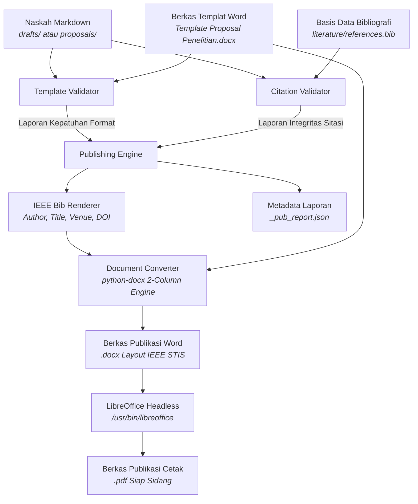

# Panduan Alur Kerja Penerbitan Dokumen Publikasi (.docx & .pdf)

Dokumen ini menjelaskan arsitektur, spesifikasi teknis, dan panduan penggunaan **Pipeline Penerbitan Dokumen Akhir** (*Document Publishing & Compilation Pipeline*) yang mengompilasi naskah Markdown dan basis data bibliografi menjadi berkas publikasi siap pakai berstandar IEEE dua kolom Politeknik Statistika STIS.

---

## 1. Arsitektur Sistem

Pipeline ini menghubungkan naskah Markdown hasil penulisan dengan berkas templat Microsoft Word (`proposals/Template Proposal Penelitian.docx`), pangkalan data sitasi BibTeX (`literature/references.bib`), serta engine konverter dokumen berkecepatan tinggi:



---

## 2. Komponen Modul Internal (`src/calm_carson/publisher/`)

### A. Data Models (`models.py`)
- **`ValidationIssue`**: Merekam kode kesalahan (`code`), kategori (`template`, `citation`, `metadata`), tingkat keparahan (`INFO`, `WARNING`, `ERROR`), lokasi baris, dan rekomendasi solusi (`suggestion`).
- **`TemplateValidationReport`**: Merekam skor kepatuhan naskah (0–100), status kepatuhan (`is_compliant`), rincian isu, status sub-bab, serta metadata judul, penulis, NIM, jumlah kata abstrak, dan jumlah kata kunci.
- **`CitationValidationReport`**: Merekam total kemunculan sitasi, jumlah sitasi unik, daftar sitasi cocok, sitasi rusak/hilang (*broken citations*), rujukan belum dikutip (*orphan references*), serta anomali lompatan urutan nomor sitasi IEEE (*out-of-order*).
- **`PublicationConfig`**: Konfigurasi eksekusi (path templat, format output `docx`/`pdf`/`all`, opsi auto-renumber sitasi, strict CI mode, dan direktori output).
- **`PublishResult`**: Hasil akhir penerbitan memuat path berkas `.docx`, `.pdf`, dan objek laporan validasi.

### B. Template Validator (`template_validator.py`)
Memeriksa keselarasan struktur naskah terhadap template resmi STIS (`Template Proposal Penelitian.docx`):
1. **Metadata & Frontmatter**:
   - Judul naskah (H1 `# ...`).
   - Penulis, NIM, Kelas, dan Dosen Pembimbing/Pengampu.
   - Ringkasan / Abstrak: Memvalidasi batas panjang ringkasan ($\le 160$ kata sesuai aturan IEEE).
   - Kata Kunci: Memvalidasi batas jumlah kata kunci ($\le 5$ kata kunci).
2. **Kelengkapan Bab & Bagian**:
   - Bab I / Pendahuluan: Latar Belakang Masalah, Rumusan Masalah, Tujuan Penelitian, Batasan Masalah.
   - Bab II / Tinjauan Pustaka: Landasan Teori, Tabel Kontribusi Penelitian (Tabel I), Kesenjangan Penelitian & Urgensi.
   - Bab III / Metodologi Penelitian: Desain DSRM, Arsitektur Sistem, Alat & Lingkungan Komputasi, Evaluasi / Pengujian, Rancangan Jadwal 10 Bulan (Tabel II).
   - Bab IV (Hasil & Pembahasan) dan Bab V (Penutup) otomatis divalidasi jika naskah berlingkup skripsi penuh (`scope="thesis"`).
   - Daftar Pustaka: Memeriksa keberadaan seksi bibliografi atau berkas rujukan eksternal.
3. **Standar Pengujian Panel Dosen STIS**:
   - Minimal 3 masalah konkret pada Latar Belakang.
   - Keberadaan data empiris kuantitatif riil (angka statistik/persentase).
   - Keberadaan Tabel I (Literature Comparison) dan Tabel II (Jadwal 10 Bulan).

### C. Citation Validator (`citation_validator.py`)
Memeriksa integritas hubungan antara penanda sitasi di badan naskah dan entri rujukan:
1. **Ekstraksi Sitasi Cerdas**:
   - Mendukung format numerik IEEE (`[1]`, `[2], [3]`, `[4]-[6]`, `[10]`).
   - Mendukung format kunci BibTeX (`[@key]`, `@key`, `\cite{key}`).
   - Kebal terhadap tautan Markdown (`[teks](url)`), diagram kotak ASCII (`│`, `┌`, `└`), blok kode (```), dan notasi interval matematika (`in [0, 1]`).
2. **Pencocokan Multi-Sumber**:
   - Mencocokkan terhadap berkas BibTeX eksternal (`literature/references.bib`).
   - Mencocokkan terhadap daftar pustaka inline pada Markdown (`## VI. Daftar Pustaka`).
3. **Pendeteksian Anomali**:
   - *Broken Citations*: Menandai nomor sitasi di teks yang tidak memiliki sumber di daftar pustaka.
   - *Orphan References*: Menandai entri referensi yang ada di bibliografi namun tidak pernah dikutip di teks.
   - *Chronological Order Gap*: Mendeteksi sitasi numerik yang melompati urutan kemunculan pertama.
   - *Metadata Completeness*: Memeriksa kelengkapan nama penulis dan tahun terbit pada setiap rujukan.

### D. IEEE Bibliography Renderer (`bib_renderer.py`)
Merender entri bibliografi menjadi teks rujukan berstandar IEEE resmi:
- **Artikel Jurnal**: `[X] A. Author, "Title," Journal Name, vol. X, no. Y, pp. xx–yy, Year, doi: 10.xxxx.`
- **Prosiding Seminar / Konferensi**: `[X] A. Author, "Title," in Proc. Conf Name, Location, Year, pp. xx–yy, doi: 10.xxxx.`
- **Buku**: `[X] A. Author, Title. Location: Publisher, Year.`
- **Bab Buku**: `[X] A. Author, "Chapter Title," in Book Name, Publisher, Year, pp. xx–yy.`
- **Skripsi Alumni STIS**: `[X] A. Author, "Title," Skripsi Sarjana Terapan, Politeknik Statistika STIS, Year. [Online]. Available: ...`
- **Laporan Resmi / Website**: `[X] Organization, Title, Location, Year.`
- **Fitur Auto-Renumbering**: Memetakan ulang penomoran sitasi di teks dan menyusun daftar pustaka berurutan secara otomatis ($1, 2, 3, \dots$).

### E. Document Converter (`converter.py`)
Mengonversi Markdown menjadi dokumen Word `.docx` dan PDF:
1. **Injeksi Templat Word**:
   - Mempertahankan font **Times New Roman**, margin resmi (Atas 19 mm, Bawah 43 mm, Kiri/Kanan 14,32 mm).
   - Menjaga struktur layout IEEE: **Seksi 0** (1 kolom penuh untuk Judul, Penulis, NIM, Kelas, Dosen, Abstrak, dan Kata Kunci) dan **Seksi 1** (2 kolom kontinu dengan spasi 4,22 mm untuk isi naskah dan daftar pustaka).
2. **Perenderan Elemen Markdown**:
   - Heading H1 dipetakan ke gaya Romawi kapital berpusat (`I. PENDAHULUAN`).
   - Heading H2 dipetakan ke gaya huruf miring tebal (`A. Latar Belakang Masalah`).
   - Heading H3 dipetakan ke gaya penomoran Arab (`1) Masalah Pertama:`).
   - Paragraf rata kiri-kanan (justified) dengan indentasi baris pertama.
   - Tabel Markdown dikonversi menjadi Word Table berformat IEEE (keterangan tabel di atas: `TABEL I\nKONTRIBUSI PENELITIAN` kapital kecil, font 8pt, shading header abu-abu muda).
   - Persamaan matematika berpusat dengan nomor persamaan rata kanan `(1)`.
   - Blok kutipan (blockquote) dan daftar butir/nomor (lists) terformat rapi.
3. **Kompilasi PDF**:
   - Memanggil `/usr/bin/libreoffice --headless --convert-to pdf` untuk menghasilkan salinan PDF beresolusi tinggi tanpa degradasi tata letak.

---

## 3. Penggunaan Praktis CLI (`scripts/publish_document.py`)

Seluruh perintah dijalankan melalui lingkungan virtual lokal via `uv`:

### A. Validasi Saja (Tanpa Menghasilkan File Fisik)
Gunakan opsi `--validate-only` untuk memeriksa apakah draf naskah sudah patuh terhadap template dan seluruh sitasi telah lengkap:
```bash
uv run python scripts/publish_document.py \
  --input proposals/proposal_topik_1_survey_fraud.md \
  --validate-only
```

### B. Kompilasi Publikasi Penuh (DOCX + PDF)
Mengompilasi naskah menjadi dokumen Word dan PDF ke direktori output pilihan:
```bash
uv run python scripts/publish_document.py \
  --input proposals/proposal_topik_1_survey_fraud.md \
  --output-dir drafts/published/topik_1 \
  --format all
```

### C. Menerapkan Templat Kustom Pengguna
Gunakan flag `--template` untuk menggunakan berkas `.docx` format lain:
```bash
uv run python scripts/publish_document.py \
  --input drafts/topik_1/naskah_lengkap_skripsi.md \
  --template "proposals/Template Proposal Penelitian.docx" \
  --output-dir drafts/published/custom \
  --format all
```

### D. Penomoran Ulang Sitasi Otomatis (`--auto-renumber`)
Jika naskah memiliki sitasi yang melompati urutan kronologis, aktifkan flag `--auto-renumber` untuk menyelaraskan nomor sitasi teks secara berurutan:
```bash
uv run python scripts/publish_document.py \
  --input drafts/topik_1/naskah_lengkap_skripsi.md \
  --output-dir drafts/published/topik_1 \
  --auto-renumber \
  --format all
```

### E. Mode Ketat untuk Gatekeeper CI/CD (`--strict`)
Mengembalikan exit code 1 dan menghentikan proses jika ditemukan sitasi rusak atau bagian wajib template yang hilang:
```bash
uv run python scripts/publish_document.py \
  --input proposals/proposal_topik_1_survey_fraud.md \
  --strict
```

---

## 4. Struktur Luaran Berkas Publikasi

Berkas luaran tersimpan pada direktori target (misal `drafts/published/<topik>/`):
```text
drafts/published/topik_1/
├── proposal_topik_1_survey_fraud.docx         # Dokumen Word dua kolom berformat IEEE
├── proposal_topik_1_survey_fraud.pdf          # Berkas PDF resmi siap cetak / sidang
└── proposal_topik_1_survey_fraud_pub_report.json # Rekam jejak audit kepatuhan & sitasi
```

Contoh metadata rekam jejak publikasi (`_pub_report.json`):
```json
{
  "manuscript": "proposal_topik_1_survey_fraud",
  "success": true,
  "docx_path": ".../drafts/published/topik_1/proposal_topik_1_survey_fraud.docx",
  "pdf_path": ".../drafts/published/topik_1/proposal_topik_1_survey_fraud.pdf",
  "template_compliance_score": 90.0,
  "template_issues_count": 2,
  "citation_issues_count": 15,
  "total_citations": 97,
  "total_bib_entries": 37
}
```
