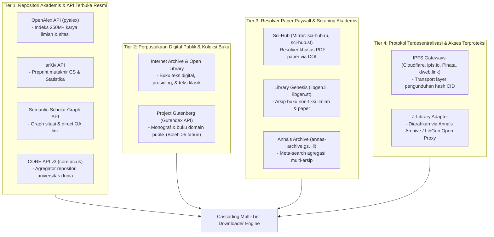

# Dokumentasi Perkakas: International & Multi-Archive Literature Scraper

Panduan teknis dan operasional untuk perkakas pencari dan pengunduh publikasi ilmiah internasional, repositori terbuka, dan monograf pendidikan pada repositori riset skripsi `calm-carson`.

Perkakas ini diimplementasikan dalam skrip Python [`scripts/scrape_international.py`](../scripts/scrape_international.py) dan modul internal [`src/calm_carson/archives/`](../src/calm_carson/archives/).

---

## 1. Ikhtisar & Arsitektur Multi-Arsip (Multi-Tier Open Archives)

Sistem mengintegrasikan **9 public open archive** yang dikelompokkan ke dalam 4 tingkatan prioritas (*tiered architecture*):



### Karakteristik & Kebijakan Arsip:
1. **Tier 1 (Akademis Resmi - Aktif Default)**:
   - **OpenAlex & arXiv**: Sumber utama indeks sitasi dan preprint komputer/statistik.
   - **Semantic Scholar**: Graph akademis Allen AI untuk melacak sitasi dan OA PDF.
   - **CORE (core.ac.uk)**: Agregator repositori kampus terbesar dunia dengan tautan PDF institusi.
2. **Tier 2 (Perpustakaan Publik)**:
   - **Internet Archive / Open Library**: Menelusuri buku teks dan prosiding ber-ISBN/ark.
   - **Project Gutenberg**: Dipisahkan khusus untuk kategori **Buku/Monograf Klasik** (diperbolehkan dikutip dalam skripsi meskipun terbit > 5 tahun).
3. **Tier 3 (Paywall Resolver & Shadow Catalog)**:
   - **Sci-Hub, LibGen, Anna's Archive**: Diaktifkan secara eksplisit via `--sources shadow` atau bertindak sebagai *automatic cascading fallback* saat mengunduh PDF paper berbayar via DOI.
4. **Tier 4 (Terdesentralisasi & Proxy)**:
   - **IPFS**: Gateway transport terdesentralisasi berbasis Content ID (CID).
   - **Z-Library**: Diakses secara publik tanpa login/captcha melalui meta-indeks Anna's Archive dan LibGen.

---

## 2. Cara Menjalankan Perkakas (Quick Start)

Perkakas dijalankan menggunakan runtime `uv`:

```bash
# Menjalankan pencarian default (OpenAlex, arXiv, S2, CORE, Internet Archive):
uv run python scripts/scrape_international.py --query "differential privacy" --limit 5

# Menjalankan pencarian dengan preset topik skripsi STIS:
uv run python scripts/scrape_international.py --topic 1 --limit 10
```

### Opsi Perintah Utama

| Argumen | Tipe | Nilai Bawaan | Keterangan |
|---|---|---|---|
| `--query` | String | `None` | Kata kunci pencarian bebas (misal: `"survey falsification paradata"`) |
| `--topic` | Pilihan | `None` | Preset topik skripsi: `1` (Survey Fraud), `2` (SDI Gateway), `3` (Microdata Privacy) |
| `--sources`, `--source` | String | `default` | Preset sumber: `default`, `academic`, `libraries`, `books`, `shadow`, `all`, atau koma-terpisah |
| `--include-books` | Flag | `False` | Mengaktifkan Project Gutenberg & buku klasik (dikecualikan dari batas ketat 5 tahun) |
| `--min-year` | Integer | `2021` | Batas tahun minimal (sesuai aturan STIS $\ge 2021$) |
| `--max-year` | Integer | `2026` | Batas tahun maksimal |
| `--limit` | Integer | `10` | Batas jumlah artikel per sumber data |
| `--download-pdf`| Flag | `False` | Unduh otomatis seluruh berkas PDF melalui *Cascading Multi-Tier Downloader* |
| `--no-fallback` | Flag | `False` | Matikan fallback Sci-Hub/LibGen jika URL Open Access awal tertutup |
| `--no-convert-md` | Flag | `False` | Jangan otomatis mengonversi PDF terunduh ke Markdown via Marker GPU |
| `--output-dir` | String | `literature` | Folder penyimpanan file JSON, CSV, dan Markdown |

---

## 3. Contoh Penggunaan Praktis

### A. Pencarian Akademis Murni (Tier 1)
```bash
uv run python scripts/scrape_international.py --query "zero trust API gateway metadata" --sources academic --limit 5
```

### B. Pencarian Buku Teks & Monograf Edukasi (Tier 2)
```bash
# Mencari buku dan risalah klasik statistik (Gutenberg + Internet Archive):
uv run python scripts/scrape_international.py --query "theory of probability statistics" --sources books --include-books --limit 5
```

### C. Pencarian Melibatkan Shadow Archives (Tier 3 Eksplisit)
```bash
uv run python scripts/scrape_international.py --query "statistical disclosure control" --sources shadow --limit 5
```

### D. Mengunduh Paper dengan Cascading Fallback & Konversi GPU
Tambahkan argumen `--download-pdf`:
```bash
uv run python scripts/scrape_international.py --topic 3 --limit 5 --download-pdf
```
*Mekanisme Unduh Bertingkat:*
1. Menguji URL Open Access Resmi (OpenAlex, arXiv, S2, CORE).
2. Jika gagal atau tertutup paywall, otomatis menuruni tangga fallback: **Sci-Hub $\rightarrow$ Library Genesis $\rightarrow$ IPFS**.
3. Memeriksa *magic bytes* header binary `b'%PDF-'` untuk memastikan file bukan halaman web blokir/captcha HTML.
4. Berkas PDF valid disimpan ke `literature/pdfs/` dan langsung dikonversi ke Markdown beresolusi tinggi (beserta rumus LaTeX) via GPU NVIDIA RTX 4050.

---

## 4. Struktur Data Output

| Berkas | Format | Deskripsi |
|---|---|---|
| `literature/international_papers*.json` | JSON | Database lengkap artikel dan buku dari seluruh arsip |
| `literature/international_papers*.csv` | CSV | Tabel spreadsheet untuk telaah bibliometrik dan sitasi |
| `literature/international_papers*.md` | Markdown | Laporan kajian literatur akademis lengkap dengan kolom Sumber & Kategori |
| `literature/pdfs/INTL_*.pdf` | PDF Binary | Berkas dokumen PDF lengkap hasil unduhan tervalidasi |
| `literature/markdowns/INTL_*/` | Markdown + Images | Hasil konversi Markdown beresolusi tinggi dari Marker GPU |

---

## 5. Kepatuhan Standar Proposal Skripsi STIS

1. **Aturan 5 Tahun Terkini ($\ge 2021$)**: Otomatis diterapkan untuk seluruh artikel jurnal, prosiding, dan preprint.
2. **Pengecualian Khusus Buku/Monograf**: Literatur buku dan risalah klasik (melalui Project Gutenberg & Internet Archive) diizinkan melampaui batas 5 tahun untuk landasan teori fundamental (*formal mathematical foundations*).
3. **Integritas Bebas Halusinasi**: Seluruh metadata (DOI, URL, abstrak, venue, sitasi) diambil secara deterministik dari API dan repositori riil.
