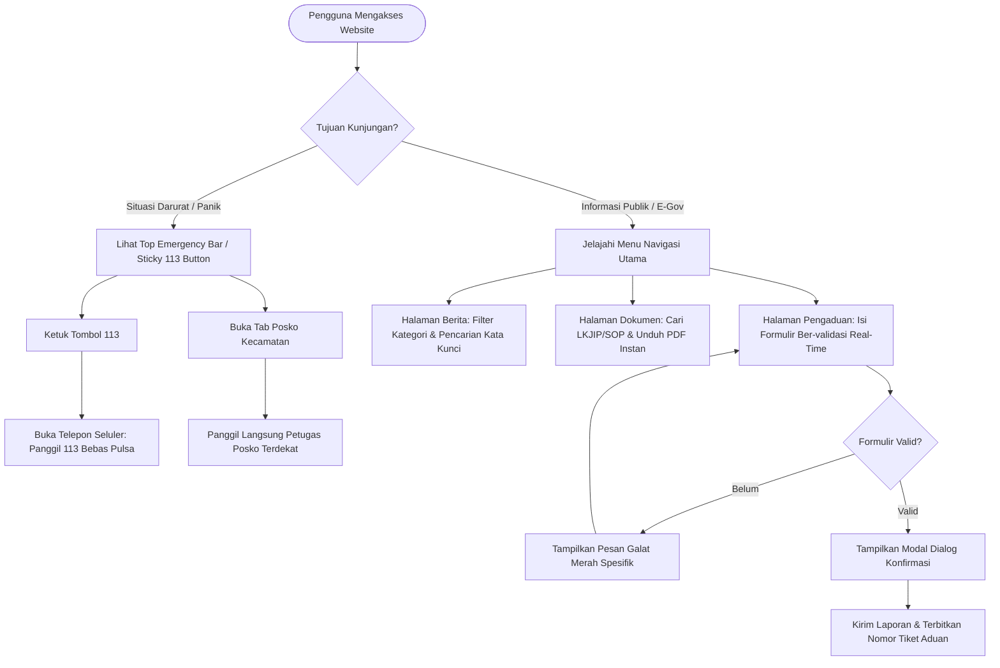

# Rancangan Wireframe dan Mockup (Low Fidelity) Website Redesign Dinas Pemadam Kebakaran dan Penyelamatan Kota Bandar Lampung

Dokumen ini menyajikan spesifikasi arsitektur antarmuka, kerangka tata letak monokromatik (*low-fidelity wireframe*), tata ruang elemen (*layout mockup*), serta pemodelan alur interaksi pengguna (*user flow*) yang diturunkan secara langsung dari sistem web fungsional yang telah diimplementasikan pada direktori `Website Redesign/` (`https://damkar-bandarlampung-redesign-5wxa.vercel.app`).

---

## 1. Landasan Desain Fidelitas Rendah (*Low-Fidelity Design Philosophy*)

Perancangan *low-fidelity wireframe* bertujuan memetakan struktur tata letak informasi (*spatial information layout*), hierarki visual (*visual hierarchy*), alokasi target sentuh (*touch target allocation*), serta alur navigasi tanpa distraksi ornamen grafis, warna kompleks, maupun tipografi dekoratif (Camburn et al., 2017; Sharp et al., 2019). 

Pendekatan ini berorientasi pada tiga prinsip utama Interaksi Manusia dan Komputer (IMK):
1. **Mitigasi Beban Kognitif Warga (*Cognitive Load Mitigation*)**: Memastikan jalur evakuasi informasi darurat (nomor telepon 113 dan kontak posko) dapat ditemukan dalam waktu kurang dari 3 detik (1 ketukan langsung) saat pengguna berada dalam kondisi panik (Norman, 2004).
2. **Kepatuhan Hukum Fitts (*Fitts's Law*)**: Menempatkan tombol darurat dan kontrol utama pada posisi persisten dengan ukuran target interaktif minimal 44 × 44 piksel pada perangkat seluler guna mencegah salah sentuh (*slips and mistakes*).
3. **Kepatuhan Standar Pelayanan Minimal (SPM) 15 Menit**: Mengomunikasikan komitmen waktu tanggap Permendagri No. 114 Tahun 2018 secara eksplisit pada tajuk utama dan area beranda situs.

---

## 2. Elemen Kerangka Global Persisten (*Global Persistent Framework*)

Di seluruh halaman website, terdapat 3 komponen kerangka persisten yang selalu hadir mengawal navigasi pengguna:
1. **Top Emergency Bar (Header Tingkat 1)**: Bilah informasi darurat di bagian teratas layar.
2. **Main Navigation Bar (Header Tingkat 2)**: Bilah navigasi utama sticky dengan penanda menu aktif dan pencarian global.
3. **Persistent Sticky 113 Emergency Button**: Tombol aksi melayang di sudut kanan bawah peramban (`fixed bottom-6 right-6 z-50`) dengan animasi denyut (*pulse*).
4. **Unified Footer**: Bilah kaki halaman komprehensif berisi kontak mako pusat, tautan cepat, dan jam kesiapsiagaan 24/7.

### Skematik Wireframe Global Header & Persistent Floating Button:
```text
+-----------------------------------------------------------------------------------------------+
| TOP EMERGENCY BAR                                                                             |
| [!] POSKO SIAGA 24 JAM PENUH  |  Hotline: 113 / (0721) 252741  |  SPM Waktu Tanggap < 15 Mnt  |
+-----------------------------------------------------------------------------------------------+
| MAIN STICKY NAVBAR                                                                            |
| [LOGO] DAMKAR BANDAR LAMPUNG    [Beranda] [Profil v] [Berita] [Dokumen] [Galeri] [Kontak] [Q]|
+-----------------------------------------------------------------------------------------------+
|                                                                                               |
|                                       ( KONTEN HALAMAN )                                      |
|                                                                                               |
|                                                                          +------------------+ |
|                                                                          | [!] DARURAT: 113 | |
|                                                                          | (Sticky Floating)| |
|                                                                          +------------------+ |
+-----------------------------------------------------------------------------------------------+
| UNIFIED FOOTER                                                                                |
| - Identitas Dinas Pemadam Kebakaran & Penyelamatan Kota Bandar Lampung                        |
| - Alamat: Jl. Kapten Piere Tendean No. 2, Teluk Betung Selatan, Kota Bandar Lampung           |
| - Tautan Cepat Layanan  |  Statistik Ringkas  |  Hak Cipta (c) 2026 Pemerintah Kota B. Lampung|
+-----------------------------------------------------------------------------------------------+
```

---

## 3. Wireframe & Mockup Low-Fidelity Per Modul Utama

### 3.1 Modul 1: Beranda Utama (*Homepage*)
Halaman beranda berfungsi sebagai gerbang utama (*primary landing portal*) yang membagi akses pengguna ke dalam dua jalur cepat: jalur tanggap darurat krisis (*emergency fast-track*) dan jalur layanan publik kedinasan (*e-government track*).

#### Skematik Wireframe Low-Fidelity:
```text
+-----------------------------------------------------------------------------------------------+
| [TOP BAR] Status Operasional 24 Jam | Call Center 113 Bebas Pulsa | Standar Waktu Tanggap 15 M|
+-----------------------------------------------------------------------------------------------+
| [LOGO] DINAS PEMADAM KEBAKARAN & PENYELAMATAN       [Beranda*] [Profil] [Berita] [Kontak] [Q] |
+-----------------------------------------------------------------------------------------------+
| HERO BANNER & KESIAPSIAGAAN SPM                                                               |
| +-------------------------------------------------------------------------------------------+ |
| | [LENCANA] KESIAPSIAGAAN 24/7 - SPM WAKTU TANGGAP < 15 MENIT                               | |
| |                                                                                           | |
| |  Penyelamatan Jiwa & Penanggulangan Kebakaran Kota Bandar Lampung                          | |
| |  Siaga melayani pemadaman kebakaran dan evakuasi kedaruratan non-kebakaran warga.          | |
| |                                                                                           | |
| |  [ BUTTON: HUBUNGI 113 SEKARANG ]      [ BUTTON: LIHAT POSKO KECAMATAN ]                  | |
| |                                                                                           | |
| |  (<) Prev Slide                    [ * ] [ o ] [ o ]                       Next Slide (>) | |
| +-------------------------------------------------------------------------------------------+ |
+-----------------------------------------------------------------------------------------------+
| AKSES CEPAT LAYANAN UTAMA (6 QUICK ACTION SHORTCUTS)                                          |
| +-----------------+ +-----------------+ +-----------------+ +-----------------+               |
| | [i] PENGUMUMAN  | | [N] BERITA AKSI | | [D] DOKUMEN SOP | | [P] POSKO SIAGA |               |
| | Info Seleksi/SOP| | Laporan Pemadam | | Unduh LKJIP/SOP | | 6 Markas Wilayah|               |
| +-----------------+ +-----------------+ +-----------------+ +-----------------+               |
| +-----------------+ +-----------------+                                                       |
| | [G] GALERI FOTO | | [?] BANTUAN FAQ |                                                       |
| | Dokumentasi Lap.| | Tanya Jawab     |                                                       |
| +-----------------+ +-----------------+                                                       |
+-----------------------------------------------------------------------------------------------+
| DASBOR VISUALISASI STATISTIK OPERASIONAL (2024 - 2025)                                        |
| +-------------------------------------------------------------------------------------------+ |
| | [Stat 1: Kebakaran]    [Stat 2: Penyelamatan]    [Stat 3: Armada]    [Stat 4: SPM Respon] | |
| |      271 Kejadian           518 Aksi Rescue          14 Unit              < 15 Menit      | |
| |      (Tahun 2024)            (Tahun 2025)          Siaga Operasi        Permendagri 114   | |
| +-------------------------------------------------------------------------------------------+ |
+-----------------------------------------------------------------------------------------------+
| BERITA & PENGUMUMAN TERKINI                                                                   |
| +-------------------------------------------+  +--------------------------------------------+ |
| | [KARTU BERITA 1]                          |  | [PENGUMUMAN PENTING]                       | |
| | [ Foto Thumbnail ]                        |  | [Lencana: DARURAT] Siaga Cuaca Ekstrem     | |
| | Kategori: Operasi Pemadaman - 12 Jan 2026 |  | Waspada potensi kebakaran lahan & angin.   | |
| | Judul: Damkar Padamkan Kebakaran Gudang.. |  |                                            | |
| | [ Baca Selengkapnya -> ]                  |  | [Lencana: PENTING] Rekrutmen Relawan PTK   | |
| +-------------------------------------------+  +--------------------------------------------+ |
+-----------------------------------------------------------------------------------------------+
| DIREKTORI POSKO DARURAT TERDEKAT                                                              |
| [Posko Sukarame: 0812-xxxx]  [Posko Kedaton: 0813-xxxx]  [Posko Kemiling: 0811-xxxx]          |
| [Button: Panggil Posko 1-Klik] [Button: Panggil Posko 1-Klik] [Button: Panggil Posko 1-Klik] |
+-----------------------------------------------------------------------------------------------+
```

---

### 3.2 Modul 2: Berita dan Pengumuman (*News & Announcements*)
Modul berita dan pengumuman menyajikan dokumentasi kegiatan penanggulangan bencana, sosialisasi bahaya kebakaran, serta edaran kedinasan dengan sistem penyaringan kata kunci dinamis di sisi klien (*client-side dynamic filtering*).

#### Skematik Wireframe Low-Fidelity:
```text
+-----------------------------------------------------------------------------------------------+
| NAVBAR STICKY                                                                                 |
+-----------------------------------------------------------------------------------------------+
| BREADCRUMB: Beranda > Berita dan Informasi                                                    |
|                                                                                               |
| JUDUL HALAMAN: Warta & Informasi Kedinasan Pemadam Kebakaran                                  |
| Keterangan: Publikasi operasi penanganan kebakaran, aksi penyelamatan warga, dan edukasi.     |
+-----------------------------------------------------------------------------------------------+
| PENCARIAN & PENYARINGAN FASET IN-PAGE (< 100 ms latency)                                      |
| [ Search input: "Ketik kata kunci berita (misal: evakuasi, kebakaran)..."             ] [ X ]|
|                                                                                               |
| Kategori Filter: [ (•) Semua ]  [ Operasi Pemadaman ]  [ Penyelamatan Rescue ]  [ Sosialisasi]|
+-----------------------------------------------------------------------------------------------+
| STATUS HASIL: Menampilkan 8 artikel berita                                                    |
+-----------------------------------------------------------------------------------------------+
| GRID ARTIKEL BERITA (3 Kolom Responsif)                                                       |
| +-----------------------+  +-----------------------+  +-----------------------+               |
| | [ Gambar Foto ]       |  | [ Gambar Foto ]       |  | [ Gambar Foto ]       |               |
| | Lencana: Pemadaman    |  | Lencana: Rescue       |  | Lencana: Sosialisasi  |               |
| | Tgl: 14 Februari 2026 |  | Tgl: 10 Februari 2026 |  | Tgl: 05 Februari 2026 |               |
| | Judul: Respon Cepat   |  | Judul: Evakuasi Sarang|  | Judul: Simulasi Bahaya|               |
| | Armada Tangani Ruko.. |  | Tawon Vespa di Atap.. |  | Kebakaran di Sekolah..|               |
| | Ringkasan teks max    |  | Ringkasan teks max    |  | Ringkasan teks max    |               |
| | 2 baris terpotong...  |  | 2 baris terpotong...  |  | 2 baris terpotong...  |               |
| | [ Baca Rinci -> ]     |  | [ Baca Rinci -> ]     |  | [ Baca Rinci -> ]     |               |
| +-----------------------+  +-----------------------+  +-----------------------+               |
+-----------------------------------------------------------------------------------------------+
| PAGINATION / NAVIGASI HALAMAN: [ (<) Sebelumnya ]  [ 1 ]  [ 2 ]  [ 3 ]  [ Selanjutnya (>) ]   |
+-----------------------------------------------------------------------------------------------+
```

---

### 3.3 Modul 3: Dokumen Publik dan SOP Perizinan (*Public Documents*)
Modul dokumen mengimplementasikan pilar keterbukaan informasi publik dan akuntabilitas e-government, menyediakan repositori berkas akuntabilitas instansi dan pedoman teknis keselamatan kebakaran.

#### Skematik Wireframe Low-Fidelity:
```text
+-----------------------------------------------------------------------------------------------+
| BREADCRUMB: Beranda > Dokumen Publik & SOP                                                    |
|                                                                                               |
| JUDUL: Repositori Dokumen Publik & Standar Operasional Prosedur (SOP)                          |
| Deskripsi: Unduh dokumen kinerja resmi (LKJIP), rencana strategis, dan SOP proteksi kebakaran.|
+-----------------------------------------------------------------------------------------------+
| BILAH PENCARIAN & FILTER FASET DOKUMEN                                                        |
| [ Search input: "Cari judul dokumen atau nomor regulasi..."                            ] [ X ]|
|                                                                                               |
| Filter Pil: [ (•) Semua Kategori ]  [ LKJIP ]  [ Renstra ]  [ SOP Proteksi ]  [ Formulir ]    |
+-----------------------------------------------------------------------------------------------+
| DAFTAR DOKUMEN (Interactive Table / List View)                                                |
| +-------------------------------------------------------------------------------------------+ |
| | [PDF Icon] Laporan Kinerja Instansi Pemerintah (LKJIP) Tahun 2025                         | |
| | Kategori: LKJIP  |  Ukuran: 3.4 MB  |  Tahun: 2025  |  Format: Adobe PDF                  | |
| | Ringkasan: Berkas laporan pertanggungjawaban pencapaian sasaran strategis dinas damkar.   | |
| | [ Button: Unduh Berkas PDF (v) ]       [ Button: Pratinjau / Ringkasan ]                  | |
| +-------------------------------------------------------------------------------------------+ |
| | [PDF Icon] Standar Operasional Prosedur (SOP) Pengujian Alat Proteksi Kebakaran Gedung   | |
| | Kategori: SOP Proteksi  |  Ukuran: 1.8 MB  |  Tahun: 2024  |  Format: Adobe PDF           | |
| | Ringkasan: Panduan teknis inspeksi hidran, sprinkler, dan APAR pada bangunan bertingkat. | |
| | [ Button: Unduh Berkas PDF (v) ]       [ Button: Pratinjau / Ringkasan ]                  | |
| +-------------------------------------------------------------------------------------------+ |
| | [PDF Icon] Rencana Strategis (Renstra) Dinas Pemadam Kebakaran 2021-2026                  | |
| | Kategori: Renstra  |  Ukuran: 4.1 MB  |  Tahun: 2021  |  Format: Adobe PDF                | |
| | Ringkasan: Dokumen perencanaan program jangka menengah penanggulangan kebakaran.          | |
| | [ Button: Unduh Berkas PDF (v) ]       [ Button: Pratinjau / Ringkasan ]                  | |
| +-------------------------------------------------------------------------------------------+ |
+-----------------------------------------------------------------------------------------------+
| TOAST NOTIFIKASI SUKSES (Muncul di Kanan Bawah saat Klik Unduh):                              |
| [✓] "Memulai pengunduhan berkas LKJIP_2025.pdf (3.4 MB)..."                                   |
+-----------------------------------------------------------------------------------------------+
```

---

### 3.4 Modul 4: Galeri Dokumentasi Kegiatan (*Activity Gallery*)
Modul galeri menyajikan bukti visual keterlibatan aparatur di lapangan dengan modal interaktif (*lightbox*) yang mendukung aksesibilitas navigasi papan ketik penuh.

#### Skematik Wireframe Low-Fidelity:
```text
+-----------------------------------------------------------------------------------------------+
| BREADCRUMB: Beranda > Galeri Dokumentasi                                                      |
|                                                                                               |
| JUDUL: Galeri Dokumentasi Lapangan Dinas Pemadam Kebakaran & Penyelamatan                     |
+-----------------------------------------------------------------------------------------------+
| PENYARINGAN KATEGORI AKSI                                                                     |
| Filter Pil: [ (•) Semua Dokumentasi ]  [ Pemadaman ]  [ Penyelamatan Rescue ]  [ Sosialisasi] |
+-----------------------------------------------------------------------------------------------+
| GRID FOTO DOKUMENTASI (Thumbnail Cards)                                                       |
| +------------------------+  +------------------------+  +------------------------+            |
| | [ Foto Thumbnail 1 ]   |  | [ Foto Thumbnail 2 ]   |  | [ Foto Thumbnail 3 ]   |            |
| | Aksi Pemadaman Ruko    |  | Evakuasi Ular Sanca    |  | Sosialisasi Dini Siswa |            |
| | [Icon Zoom / Klick]    |  | [Icon Zoom / Klick]    |  | [Icon Zoom / Klick]    |            |
| +------------------------+  +------------------------+  +------------------------+            |
+-----------------------------------------------------------------------------------------------+
|                                                                                               |
| MODAL LIGHTBOX INTERAKTIF (Saat Foto Diklik):                                                 |
| +-------------------------------------------------------------------------------------------+ |
| | [ MODAL OVERLAY GELAP ]                                            [ Tombol Tutup (X/ESC) ]|
| |                                                                                           | |
| |   (< Panah Kiri)                     [ FOTO RESOLUSI PENUH ]               (Panah Kanan >)| |
| |                                                                                           | |
| |   Keterangan: Operasi Pemadaman Kebakaran Pasar Tengah Bandar Lampung - Tim Regu 2        | |
| |   Lokasi: Tanjung Karang Pusat  |  Tanggal: 18 Januari 2026                               | |
| +-------------------------------------------------------------------------------------------+ |
+-----------------------------------------------------------------------------------------------+
```

---

### 3.5 Modul 5: Kontak, Posko Siaga, dan Formulir Pengaduan Cerdas (*Contact & Emergency*)
Modul kontak merupakan inti dari rekayasa interaksi kedaruratan, menggabungkan formulir pelaporan interaktif dengan validasi seketika (*real-time validation*) serta direktori panggilan cepat 6 posko siaga kecamatan.

#### Skematik Wireframe Low-Fidelity:
```text
+-----------------------------------------------------------------------------------------------+
| BREADCRUMB: Beranda > Kontak & Posko Kedaruratan                                              |
|                                                                                               |
| JUDUL: Kanal Darurat, Pengaduan Warga, dan Direktori Posko Kecamatan                          |
| Keterangan: Akses panggilan siaga 24/7 dan pelaporan kejadian kebakaran / evakuasi satwa liar.|
+-----------------------------------------------------------------------------------------------+
| KANAL PANGGILAN DARURAT CEPAT (TOP ACTION BOX)                                                |
| +-----------------------------------+   +---------------------------------------------------+ |
| | [!] HOTLINE DAMKAR: 113           |   | [Mako Pusat]: (0721) 252741                       | |
| | Bebas Pulsa - Siaga 24 Jam Penuh  |   | Jl. Kapten Piere Tendean No. 2, Teluk Betung S.   | |
| | [ BUTTON: PANGGIL 113 SEKARANG ]  |   | [ BUTTON: HUBUNGI TELEPON KANTOR ]                | |
| +-----------------------------------+   +---------------------------------------------------+ |
+-----------------------------------------------------------------------------------------------+
| BAGIAN KIRI: FORMULIR PENGADUAN CERDAS      | BAGIAN KANAN: DIREKTORI 6 POSKO KECAMATAN       |
| (Real-Time Form Validation)                 | (Direct Click-to-Call Shortcuts)                |
|                                             |                                                 |
| 1. Nama Lengkap Pelapor:                    | 1. POSKO KEDATON                                |
|    [ Input teks: "Budi Santoso"         ][✓]|    Alamat: Jl. Teuku Umar No. 45, Kedaton       |
|    (Valid: hijau centang)                   |    [ BUTTON: Hubungi (0812-1111-2222) (Phone) ] |
|                                             |                                                 |
| 2. Nomor Ponsel / WhatsApp:                 | 2. POSKO SUKARAME                               |
|    [ Input tel: "081234567890"          ][✓]|    Alamat: Jl. Endro Suratmin, Sukarame         |
|    (Valid: regex nomor telepon seluler)     |    [ BUTTON: Hubungi (0812-3333-4444) (Phone) ] |
|                                             |                                                 |
| 3. Alamat Email:                            | 3. POSKO KEMILING                               |
|    [ Input email: "budi@email.com"      ][✓]|    Alamat: Jl. Imam Bonjol, Kemiling            |
|    (Valid: format email terverifikasi)      |    [ BUTTON: Hubungi (0812-5555-6666) (Phone) ] |
|                                             |                                                 |
| 4. Jenis Kategori Laporan:                  | 4. POSKO PANJANG                                |
|    [ Dropdown: Darurat Kebakaran v ]        |    Alamat: Jl. Yos Sudarso, Way Lunik, Panjang  |
|                                             |    [ BUTTON: Hubungi (0812-7777-8888) (Phone) ] |
| 5. Alamat / Lokasi Kejadian:                |                                                 |
|    [ Input teks: "Jl. Raden Intan No. 12" ] | 5. POSKO TELUK BETUNG                           |
|                                             |    Alamat: Jl. Hasanudin, Teluk Betung          |
| 6. Uraian Detail Kejadian:                  |    [ BUTTON: Hubungi (0812-9999-0000) (Phone) ] |
|    [ Textarea: "Terlihat kepulan asap tebal |                                                 |
|      di lantai 2 ruko sebelah barat..."  ][✓| 6. POSKO TANJUNG KARANG                         |
|    (Indikator: minimal 20 karakter terpenuhi|    Alamat: Jl. Raden Intan, Tanjung Karang      |
|                                             |    [ BUTTON: Hubungi (0812-1234-5678) (Phone) ] |
| [ BUTTON: KIRIM LAPORAN SEKARANG ]          |                                                 |
+---------------------------------------------+-------------------------------------------------+
|                                                                                               |
| DIALOG MODAL KONFIRMASI (Muncul Sebelum Data Terkirim - Pencegahan Kesalahan H5):             |
| +-------------------------------------------------------------------------------------------+ |
| | [!] KONFIRMASI PENGIRIMAN LAPORAN                                                         | |
| | Apakah informasi dan lokasi kejadian yang Anda masukkan sudah akurat?                     | |
| | Pelaporan palsu dapat dikenakan sanksi sesuai ketentuan hukum yang berlaku.               | |
| |                                                                                           | |
| | [ BATALKAN / PERIKSA KEMBALI ]                     [ YA, KIRIM LAPORAN RESMI ]            | |
| +-------------------------------------------------------------------------------------------+ |
|                                                                                               |
| TAMPILAN STATUS SUKSES (Setelah Dikirim):                                                     |
| +-------------------------------------------------------------------------------------------+ |
| | [✓] LAPORAN BERHASIL DITERIMA SISTEM OPERASIONAL                                          | |
| | Nomor Tiket Registrasi Aduan: #DK-2026-0214-089                                           | |
| | Petugas siaga markas komando sedang melakukan verifikasi dan penugasan armada terdekat.   | |
| +-------------------------------------------------------------------------------------------+ |
+-----------------------------------------------------------------------------------------------+
```

---

## 4. Pemodelan Alur Tugas Pengguna (*Task Flow Architecture*)



---

## 5. Ringkasan Transformasi Low-Fidelity: Before vs After

| Komponen Desain | Kondisi Awal (*Before Redesign*) | Hasil Redesain (*After Redesign*) |
| :--- | :--- | :--- |
| **Top Bar** | Statis, memuat teks keliru *"Jam Oprasional 07.00-16.00"*. | Persisten, menegaskan *"Posko Siaga 24 Jam"* dan *"SPM < 15 Menit"*. |
| **Panggilan Darurat** | Teks biasa di footer/sidebar, butuh > 4 klik penelusuran. | *Persistent Sticky 113 Button* di kanan bawah (1 ketukan langsung). |
| **Navigasi Posko** | Kontak posko kecamatan tidak tersedia di web. | Direktori kartu 6 posko siaga kecamatan berfitur *click-to-call*. |
| **Pencarian In-Page** | Kaku, lambat (2–4 detik), memicu muat ulang penuh halaman. | Pencarian instan (< 100 ms) dengan tombol pembersih silang (X). |
| **Filter Konten** | Nihil; berita dan dokumen bercampur secara vertikal. | Tombol kapsul (*pill filters*) multi-faset sekali klik. |
| **Formulir Kontak** | Tanpa validasi format input, tanpa konfirmasi sebelum kirim. | Validasi instan (nama, email regex, telepon) dan dialog modal konfirmasi. |
| **Aksesibilitas** | Kontras rendah, tautan membuka tab baru tanpa kontrol. | Lolos WCAG 2.1 AA (kontras > 4,5:1), navigasi papan ketik penuh. |
